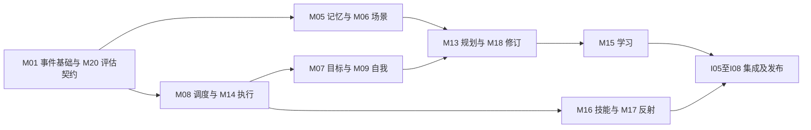

# 机器人意识系统详细研发计划

本计划对应 [总体设计](implementation-design.md)、[20 个模块专题](modules/README.md) 和 [跨模块协议与验证](system-contracts.md)。研发已开始，工作包实际状态以 [研发进度](progress.md) 为准。完整系统的工作量包括算法基线、失败案例、数据准备、运行时实现、恢复机制和集成验证。

本版替代上一版 66–101 人日、9–13 周的核心软件估算。原估算把复杂模块当作适配接口，适用于受限演示，不能作为完整项目承诺。本版估算不是将原数字按倍数放大，而是从 60 个模块工作包和 8 个集成包逐项加总。

## 交付层次

| 层次 | 可以承诺验证的能力 | 不作为该层次完成条件的内容 |
| --- | --- | --- |
| L0 确定性内核 | 文本事件、规则注意力、有界上下文、串行执行、中断与仿真恢复 | 多模态、复杂规划、在线学习 |
| L1 受限认知系统 | 证据记忆、场景、自我需求、目标、角色、短计划和矛盾处理 | 开放环境通用智能、任意技能自动学习 |
| L2 研究型完整软件 | 多模态、技能与反射候选、联想实验、版本化学习和完整回放 | 所有研究假设必定取得正结果 |
| L3 设备验证系统 | 已知设备上的状态、动作、停止和恢复协议 | 未验证设备和硬实时运动控制 |

每一层次都有支持范围与失败处理说明。L2 中研究失败的模块可以交付经过验证的基线或关闭自动功能，但必须记录范围变化，不能把接口占位宣称为完整能力。

层次与总体设计的版本对应为 L0=V0、L1=V1、L2=V2、L3=V3；G0–G5 表示研发阶段，M01–M20 表示模块，三者不混用。

## 团队容量与估算口径

建议基线团队为 2 名平台与后端工程师、3 名算法工程师、1 名测试与评估工程师，共 6 名持续投入人员。架构协调由平台负责人承担，领域标注和机器人专家按阶段支持；若这些支持工作由核心人员承担，需要从有效容量中扣除。

按每人每周 5 天、有效研发系数 65% 估算，每周约 19.5 人日。其余容量用于评审、协调、问题处理和非连续投入。各工作包的人日已包含本模块正常测试与文档；另增加 20% 项目风险储备，用于未知返工而非再次统计例行协作。

台账按主责角色归集整包预算，包含协作人员在该包上的投入，不能在另一角色下再计一次。角色容量计算暂按主责归集估算，迭代启动后需按实际分工重分配；特别是质量主责的集成包，必须预留平台和算法的修复时间。

| 范围 | 基础人日 | 计量依据 |
| --- | --- | --- |
| 平台责任模块 | 147–231 | M01、M04、M07、M08、M09、M14、M16、M17 |
| 算法责任模块 | 231–362 | M02、M03、M05、M06、M10、M11、M12、M13、M15、M18、M19 |
| 质量平台模块 | 20–30 | M20 |
| 模块合计 | 398–623 | [60 个模块包台账](work-breakdown.md) |
| 跨模块集成与发布 | 44–68 | I01–I08，见下文 |
| 核心软件基础总计 | 442–691 | 模块加集成 |
| 风险储备后预算 | 531–830 | 上述上下限分别乘 1.2 并向上取整 |
| 真实设备阶段 | 45–75 | H01–H06，另行计量；未含风险储备 |

只按总容量相除得到约 27–43 周，但这还不是日历承诺。算法 3 人的有效容量约 9.75 人日/周，其工作加风险储备约需 29–45 周；平台 2 人约需 28–43 周。考虑启动、关键依赖与最后集成，完整 L2 的规划窗口为 **36–54 周**，L0 目标约 8–12 周，受限 L1 约 20–30 周。日期需在 L0 完成后用实际吞吐重估。

若仍为 1 名平台、1 名算法和阶段性测试支持，算法容量约 3.25 人日/周，仅算法范围加储备就约 86–134 周；不能承诺用原来的两人团队在数月内实现全范围。应优先缩小到 L0/L1，或增加能独立承担模块的人员。人日均为工程初估，不含设备采购、长期数据采集等待、模型训练算力和标注服务费用。

## 分阶段里程碑

时间窗是 6 人基线下的工作安排范围，不是各阶段相加的固定合同日期；模块可按冻结契约并行。快速路径需要研究基线尽早通过且设备不在软件关键路径上。

| 阶段 | 建议安排 | 工作范围 | 退出门槛 |
| --- | --- | --- | --- |
| G0 契约与实验准备 | 第 1–4 周 | M01-A、M20-A，调度与动作契约；各算法 A 包起步 | 错误与事件字典冻结，首批轨迹和测试替身有规范，状态所有权无歧义 |
| G1 确定性内核 L0 | 第 5–12 周，最早第 8 周验收 | M01、M03 规则子集、M04 基础子集、M08、M14、M20 回放子集，I01–I02 | C01–C05、C13、C14 通过；动作槽位、中断、恢复和预算不变量成立 |
| G2 受限认知 L1 | 第 10–30 周，目标第 20–30 周验收 | M05–M07、M09–M13、M18，I03–I04 | 证据可检索、目标可判定、短计划有基线收益、冲突不静默覆盖 |
| G3 多模态与学习 | 第 22–44 周 | M02 完整范围、M06 扩展、M15–M17、M19，I05–I06 | 候选隔离、独立验证与回滚可用；研究功能逐项决定启用范围 |
| G4 稳定化 L2 | 第 32–54 周，目标第 36–54 周验收 | 剩余模块 C 包、I07–I08 | 25 类场景中软件适用项通过，72 小时长跑与恢复报告齐备 |
| G5 设备验证 L3 | 协议稳定后独立安排约 12–20 周 | H01–H06 | 设备停止、断连、未知动作核对及现场范围通过验收 |

G1 的“子集”不是把整包标记完成：M02-B 仅文本入口可先交付，音频图像视频未验收前仍为进行中；M04-B 先提取式上下文，模型摘要留待其 C 包验证。台账记录里程碑子产物及剩余范围，防止演示可用被误当作模块完成。

## 任务粒度与依赖管理

每个模块有三个工作包：A 明确契约、实验和基线，B 完成工程机制，C 做专门验证与确定范围。共有 60 包，逐项责任、依赖、人日和产物以 [工作包台账](work-breakdown.md) 为准。普通实施项拆至 2–5 人日；超过一个迭代的 B 包按内部组件分解，子项不得重复加算父包预算。

任务执行状态使用 todo、ready、in_progress、in_review、validated、blocked；这是研发管理状态，不是机器人运行时 Task 状态。ready 需接口版本、输入样例、验收条件与依赖齐备。blocked 需注明缺少的证据或接口及负责人，不允许用“算法优化中”掩盖未知范围。

该图表示主要集成依赖；具体 A/B/C 依赖以台账为准。M05 与 M18 相互引用通过先完成 M18-A 契约、再实现 M05-B、最后实现 M18-B 消除工程循环。M08 与 M14 同理，先冻结动作协议再联调。关键路径除运行时外，还包括记忆 → 规划/修订 → 学习验证，不能只优化任务调度的开发速度。

## 跨模块集成工作包

| ID | 交付与验收 | 责任 | 依赖 | 人日 |
| --- | --- | --- | --- | --- |
| I01 | 文本输入到结果的契约集成；C01、C03 | 质量，平台协作 | M01-B、M03-B、M04-B、M08-B、M14-B | 4–6 |
| I02 | 抢占、重复中断与发送窗口恢复；C02、C04、C05、C13、C14 | 质量，平台协作 | I01、M08-C、M14-C、M20-B | 5–8 |
| I03 | 记忆、场景及矛盾全链路；C08、C16、C17、C21 | 质量，算法协作 | M04-C、M05-C、M06-C、M18-C | 5–8 |
| I04 | 目标、动机、自我、角色及规划闭环；C06、C07、C09、C18–C20 | 质量，算法协作 | I01、M07-C、M09-C、M10-C、M11-C、M12-C、M13-C | 6–9 |
| I05 | 多模态输入与反射场景；C10、C22 | 质量，算法协作 | I02、M02-C、M03-C、M17-C | 6–10 |
| I06 | 学习、技能、联想与发布回滚；C11、C12、C23、C24 | 质量，平台及算法协作 | I03、I04、M15-C、M16-C、M19-C | 6–9 |
| I07 | 72 小时长跑、故障矩阵、容量及恢复；C25 | 质量，平台协作 | I02–I06、M20-C | 6–10 |
| I08 | 复现实验包、部署回滚、支持范围和发布评审 | 质量主责，平台交付 | I07 | 6–8 |
| 合计 | 集成与发布 | 团队 | — | 44–68 |

I01 的文本子集可用于 G1 演示，但若引用模块还有未完成范围，I01 全包也不提前关闭。里程碑记录子集通过，不伪造依赖已完成。跨模块测试聚焦连接与行为，模块 C 包聚焦本模块研究或故障机制，避免重复计量。

## 真实设备阶段

| ID | 工作与交付 | 前置条件 | 人日 | 退出门槛 |
| --- | --- | --- | --- | --- |
| H01 | 设备能力盘点、协议与控制器边界 | M14-A，设备与接口资料 | 5–8 | 每项能力有参数、停止、查询和幂等说明 |
| H02 | 遥测、时钟与健康适配 | H01、M09-B | 7–12 | 有效期与单位正确，失联时状态变未知 |
| H03 | 动作、停止与状态核对驱动 | H01、M14-B | 10–16 | 真停止可确认，发送窗口结果能核对 |
| H04 | 硬件在环故障测试 | H02、H03、I02 | 10–16 | C15 及中断断连场景通过，记录停止时延 |
| H05 | 受限场地任务验证与参数校准 | H04、I04 | 8–14 | 场地、对象和行为范围有实测报告 |
| H06 | 部署回滚、监控和操作手册 | H05 | 5–9 | 可停机、恢复和导出轨迹，版本可回退 |
| 合计 | 不含采购与场地等待 | — | 45–75 | 一种明确设备的初估 |

设备阶段按 1 名机器人工程师加部分平台/质量支持安排；约 12–20 周需这些支持真实可用，并留停止协议验证缓冲。若同时占用核心软件团队，则相应延后软件里程碑，不将两条排期当作互不消耗资源。

## 前两个迭代的具体安排

每个迭代 2 周，总有效容量约 39 人日；以下仅安排约 30–36 人日，留适配与评审余量。未列出的工作继续留在待办，不要求六人同时启动所有模块。

| 迭代 | 平台两人 | 算法三人 | 质量一人 | 可评审交付 |
| --- | --- | --- | --- | --- |
| 第 1 迭代 | 完成 M01-A，启动 M14-A 和 M08-A 的协议子项 | 启动 M02-A 文本基线、M05-A 本体、M13-A 计划格式 | M20-A 指标与轨迹规范 | 事件和动作样例、停止状态表、首批文本轨迹、研究基线清单 |
| 第 2 迭代 | M01-B 日志事务子项，完成 M14-A，M08-A 反例 | M03-A 排序基线、M18-A 冲突结构、继续 M05-A 和 M13-A | M20-B 虚拟时钟和模型替身子项 | 可回放的契约样例、检索标注规范、规划仿真任务定义 |

单人同时进行的主任务不超过两个。每次迭代评审展示真实产物与失败样例，更新剩余估算；研究包到预算上限仍无结论时，先提交失败报告和缩范围方案，不无期限续作。

## 完成定义与研发治理

模块包完成需接口和数据版本明确、产物可运行或实验可复现、对应异常用例通过、限制记录齐全。持久化模块还需迁移与恢复演练；模型模块还需固定验收集、基线和成本记录。代码存在或单次演示成功都不满足完成定义。

质量门槛见 [系统验证](system-contracts.md)。算法门槛可基于证据改版，但串行、证据来源、候选隔离和未知动作处理等不变量不得为赶进度降低。决策记录包含问题、选项、实验结果、采用方案与重看条件，建议按运行时、记忆、规划、学习四类维护。

每两周统计：完成工作包与剩余范围、按角色的实际吞吐、阻塞时间、测试新增失败、模型成本和估算变动。G1 后重估 L1，G2 后重估研究型 L2；若人员或硬件发生变化，更新基线而非维持不可信日期。

## 风险与范围收敛

| 风险 | 早期信号 | 处理与责任 |
| --- | --- | --- |
| 算法问题无法按工程估算收敛 | 多轮实验无基线收益 | 算法负责人限制领域，按研究退出路径交付 |
| 调度协议看似完成但物理行为不一致 | 停止回执无法核实 | 平台和机器人负责人先解决协议，冻结真实动作 |
| 数据不足或验证集泄漏 | 同场景重复样本占比高 | 质量负责人按会话隔离，补采反例并重评 |
| 模块单测通过但状态互相污染 | 多处可写同一状态 | 平台负责人收敛所有权，执行集成不变量检查 |
| 模型或驱动替换引入行为漂移 | 成本或成功率显著变化 | 重跑冻结基准，保留旧版本回滚 |
| 项目范围持续扩大 | 未进入台账的能力被加入验收 | 新增包并重估；优先保住 L0/L1 的可验证闭环 |

实际团队规模、目标设备、离线要求和模型预算仍是排期输入。当前方案允许在这些信息未定时先开展契约和仿真；相应适配或真实部署开始前必须落实，不能把未知条件写成已满足。
