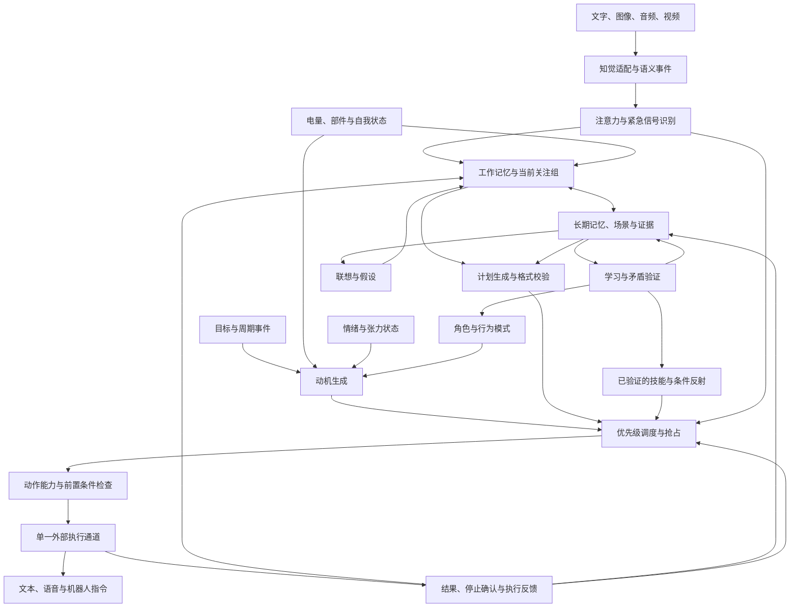

# 机器人意识系统实现设计

本设计将仓库的认知架构转化为可开发、可测试的机器人行为系统。依据为基线提交 `78f7234` 的 [架构图](../architecture.png) 与 [项目说明](../README.md)。当前提交只包含设计和研发计划，不包含运行代码。

工程目标是实现注意力、记忆、动机、任务执行与反馈的持续闭环。这里的“意识”沿用项目命名；验收对象是可观察的行为、状态与学习结果，不以主观意识是否产生作为工程验收条件。

## 范围和版本

首版采用单机器人、单进程、模块化实现。先以文本和模拟执行器验证闭环，再接入模型、多模态和机器人驱动。模块间通过结构化事件与接口通信，避免一开始拆分微服务增加调试和一致性成本。

| 版本 | 能力 | 边界 |
| --- | --- | --- |
| V0 骨架 | 文本输入、规则注意力、工作记忆、优先级调度、模拟动作、反馈追踪 | 不调用真实模型，不控制硬件 |
| V1 认知闭环 | 模型规划、长期记忆检索、场景、自我状态、动机、情绪、角色和矛盾处理 | 学习结果先作为候选，不自动上线技能 |
| V2 多模态与学习 | 图像与音频适配、技能学习、联想、条件反射候选 | 视频先采样处理；先在仿真环境验证行为 |
| V3 机器人接入 | 驱动适配、停止确认、故障恢复、硬件在环验证 | 具体范围依机器人接口和停止能力确定 |

以下语言、存储、数据结构、优先级数值与性能目标属于新增工程设计；架构图本身未规定这些细节。

## 架构图的工程映射

| 原图或说明中的模块 | 工程模块 | 负责内容 |
| --- | --- | --- |
| 文本及知觉模型 | perception | 将输入转为语义事件，保留来源、时间和置信度 |
| 注意力选择过滤 | attention | 选择当前关注的信息组，识别紧急信号，触发重新调度 |
| 工作记忆 | working_memory | 保存当前上下文及其预算，不持有所有原始媒体 |
| 长时及场景记忆 | memory | 存储事实、经历与场景，检索证据并维护版本 |
| 学习机制 | learning | 根据行为反馈提出技能、角色和反射候选 |
| 角色集及行为模式 | identity | 管理角色版本、偏好和行为模式，提供决策上下文 |
| 程序性记忆及条件反射 | skills、reflexes | 提供可执行步骤和经验证的触发规则 |
| 任务中心 | goals | 保存长期目标、周期事件、完成条件及依赖 |
| 调度中心 | scheduler | 管理任务优先级、时间片、抢占、恢复和终态 |
| 自我数据及自我模块 | self_state | 汇总电量、部件状态、行为状态并进行评估 |
| 情绪、心境、张力 | affect | 通过有界状态转换调节选择和表达 |
| 需求及动机中心 | motivation | 将需求、目标和状态转为候选任务 |
| 逻辑思维模型、格式模块 | planner、model_gateway | 请求模型生成结构化计划，校验并处理超时 |
| 联想、想象 | association | 生成带有假设标记的候选关联 |
| 反矛盾模块（说明中） | reconciliation | 检测事实与角色冲突，保留证据和待验证版本 |
| 执行器和输出反馈 | execution、feedback | 串行执行外部动作，接收结果并更新记忆和目标 |

图中的任务中心与调度中心保持分离：前者回答“要达成什么”，后者决定“当前执行什么”。记忆中的技能描述也不直接驱动硬件，必须形成任务并进入统一执行通道。

## 运行数据流

这张图把原图较抽象的“输出反馈”拆成显式结果事件。系统产生的输出携带来源标记，不能当作新的用户请求再次触发自身，避免反馈循环。

一次文本交互的顺序为：适配输入、去重、注意力选组、更新工作记忆、检索证据、生成候选计划、验证计划、调度执行、写入结果与反馈。电量和定时事件可以独立产生动机，不依赖新的用户消息。紧急信号走规则快速通道，避免等待模型推理。

## 模块接口与状态所有权

建议使用 Python 和异步事件循环构建首版。SQLite 保存本地事件与记忆元数据；工作记忆驻留内存。初期使用关键词检索，待检索基准稳定后增加向量索引。模型、向量库和机器人 SDK 均通过适配接口隔离，具体供应商和版本在相应开发阶段选择并锁定。

| 接口 | 输入 | 输出 | 状态所有者 |
| --- | --- | --- | --- |
| Perception.normalize | 原始输入引用 | SemanticEvent | 输入适配器 |
| Attention.select | 事件集合、自我状态 | FocusGroup、InterruptRequest | 注意力模块 |
| Memory.retrieve | 查询、场景、预算 | 有来源的 MemoryItem 集合 | 记忆服务 |
| Planner.propose | 上下文快照、目标、能力列表 | Plan 或结构化失败 | 规划器不修改执行状态 |
| Motivation.evaluate | 需求、目标、自我与情绪 | Motive 集合 | 动机中心 |
| Scheduler.submit | 计划或规则任务 | Task ID、受理或拒绝原因 | 调度中心 |
| Executor.start | Action、执行代次、幂等键 | ActionReceipt | 执行器 |
| Executor.cancel | Action ID、原因 | StopReceipt | 执行器 |
| Learning.propose | 轨迹、反馈、证据 | Candidate | 学习模块 |

调度器独占任务状态修改权限；执行器独占动作发送权限；记忆模块独占事实版本修改权限。后台推理只提交候选结果，不直接修改当前动作。所有回调携带执行代次，旧代次结果可记录，但不得驱动新动作。

## 数据契约与存储

| 对象 | 关键字段 | 约束 |
| --- | --- | --- |
| EventEnvelope | event_id、trace_id、causation_id、source、occurred_at、received_at、schema_version、payload | event_id 去重；设备时间和接收时间分开 |
| SemanticEvent | text、features_ref、modality、confidence、scene_id | 媒体以引用存储；置信度在 0 到 1 之间 |
| FocusGroup | group_id、event_ids、reason、expires_at | 同一机器人同一时间只有一个有效组 |
| MemoryItem | id、type、content、source_ids、confidence、valid_from、valid_to、status | type 区分事实、经历、场景、技能及假设 |
| SelfState | battery、health、current_action、updated_at | 过期的状态不能满足动作前置条件 |
| Motive | id、origin、goal_id、urgency、cooldown_key、expires_at | 相同需求合并，完成或失效后重新评估 |
| Task | id、goal_id、priority_class、deadline、status、checkpoint、generation | 状态变更记录原因和事件关联 |
| Plan | task_id、steps、expected_result、context_version | 每一步指定动作、参数、前置条件和超时 |
| Action | id、capability、arguments、idempotency_key、generation | 能力必须注册；参数和范围必须合法 |
| ActionResult | action_id、status、observation、error、generation | 区分完成、失败、停止和结果未知 |
| Candidate | kind、evidence_ids、evaluation、version、status | 未验证候选不得替换生效策略 |

建议持久化表为 events、memories、memory_evidence、scenes、goals、tasks、action_attempts、policy_versions 和 learning_candidates。tasks 的状态变化与对应事件在同一事务中写入。后续引入事件发布时使用事务发件箱，避免“状态已改但事件未发”。

工作记忆按场景、相关性与容量淘汰，保留当前目标、执行摘要及关键约束；首版建议容量 32 条，可配置。长期记忆初期只追加及版本化，不直接覆盖冲突事实。原始媒体设置单独的保留期限。事件记录用于审计与回放；从事件恢复执行状态是独立功能，不能把保存了日志等同于支持断点恢复。

## 注意力与调度

注意力以“信息组”为单位选取，多条属于同一事件的信息可以共同被关注。后台知觉允许并行，但只允许一个关注组进入当前决策上下文。普通输入根据点名、变化、与目标的相关性和语义完整度排序；紧急信号优先于这些分数。

建议优先级分为：P0 紧急停止或人身危险；P1 关键设备故障、临界电量；P2 明确用户任务和时限任务；P3 常规维护；P4 联想和空闲探索。同级按截止时间和入队顺序排序，等待老化只在非紧急级别间调整，不能超过 P0。初始阈值是可配置实验参数，不作为所有机器人通用值。

任务状态包括 queued、running、interrupt_requested、waiting_stop、paused、completed、cancelled、failed 和 outcome_unknown。终态任务不再恢复，暂停任务只有重新验证前置条件后才能重新入队。

抢占流程：记录中断原因 → 递增执行代次并使旧规划失效 → 请求执行器停止 → 等待停止确认 → 记录检查点或取消 → 执行更高优先级任务。单纯取消异步协程不等于物理动作已停止。

对外有影响的动作严格串行，包括文本和语音输出，符合原说明。纯检索、知觉和推理可以后台并发，但设置并发数、时间预算和取消令牌。时间片用于计算任务与可安全暂停的技能步骤；不得强制在不可停止的物理动作中间切换。

当停止超时或驱动失联时，任务进入 outcome_unknown，禁止后续普通动作；若硬件提供独立急停能力则使用它，并等待状态核实。无停止能力的驱动不满足接入验收条件。已发生的外部效果无法被撤销，恢复时不得从头重放整个计划。

输入队列设置上限，并按来源限流。满载时拒绝普通请求并返回可重试原因；为 P0 保留入口，必要时淘汰未运行的低优先级任务并记录原因。重复紧急信号按事件和场景合并，但不能遮蔽新的危险状态。

## 记忆、学习与矛盾处理

工作记忆保存当前上下文，场景记忆聚合时间、地点、人物和事件；长期记忆保存可追溯事实、经历和知识。程序性记忆保存技能版本及其适用条件。每次检索返回证据标识，规划器能够区分事实、过时事实和假设。

冲突处理按“实体、属性、有效时间”比较。例如同一位置在不同时间的变化不一定是矛盾；同一时刻冲突的观测建立待验证记录。结合观测时间、来源可靠度和复测结果选择生效版本，保留旧证据。无法核实则保留不确定性，必要时发起询问；不因模型表达肯定就覆盖已知事实。

学习流程为：采集轨迹 → 提出候选 → 关联成功和失败证据 → 离线回放 → 仿真验证 → 发布版本 → 监测回归并可回滚。验证样本数、成功率阈值和环境覆盖范围按技能类型配置。角色与行为模式允许更新偏好，但不得改变驱动能力限制和调度硬约束。

条件反射分为预置的确定规则和学习候选。经验证的反射可跳过模型规划，但仍需进入调度器和动作检查。联想输出统一标记为 hypothesis，不直接存为事实或技能，避免想象污染长期知识。

## 自我、情绪与动机

自我状态包含设备健康、能量、当前行为、最近失败和可用能力，并记录采样时间。设备失联时标记 unknown，不能沿用旧的正常状态。低电量动机按阈值和迟滞生成，例如低于 20% 提出充电需求、恢复到 30% 以上解除；数值仅为仿真起点，真实阈值依硬件校准。

情绪和张力使用有界变量及状态机，例如 calm、alert、recovering。事件推动状态变化，时间衰减促进恢复；状态影响表达和非紧急任务偏好，不覆盖 P0 或动作前置条件。动机由需求、目标、角色和场景共同产生，并经过合并、冷却、过期和资源预算检查。

无外部输入时由定时器触发目标检查、记忆整理和低优先级联想。首版空闲行为使用固定预算并可关闭。原说明中的自我复制等本能在设计中先表示为需求候选；复制、安装或部署不属于初期执行能力，必须另行定义执行范围与验收。

## 模型和执行器边界

模型交互统一设置输入预算、超时、取消令牌和输出 schema。模型返回计划候选，程序检查字段类型、能力名称、参数范围、步骤数、依赖关系和前置条件。结构错误最多尝试一次修复；超时或持续错误返回结构化失败，不能把未经验证的自然语言当成命令。

把输入内容和记忆作为数据传给模型；角色、工具能力和系统约束由程序维护。动作能力采用注册表，每项包含参数 schema、超时、停止方式、幂等支持及模拟实现。计划中的能力未注册时直接拒绝。

对于可能已经执行但回执丢失的动作，先查询驱动状态或依据幂等键核实；没有核实能力时标记 outcome_unknown，不能盲目重试。启动恢复时先核对上次未终结动作和当前硬件状态，再恢复可继续任务。模型降级为规则响应或询问，不猜测执行成功。

## 可观测性与验收目标

每条输入、计划、任务和动作关联 trace_id，记录关注原因、优先级、上下文版本、模型耗时、状态变化和失败原因。调试记录保留证据引用与决策摘要，不要求输出模型内部思维过程。

以下为待测目标，不是当前实测结果：

| 目标 | 验证条件 |
| --- | --- |
| 外部动作并发数始终不超过 1 | 仿真随机插入中断、错误与重试，运行至少 1000 条轨迹 |
| 紧急信号到中断请求 p95 小于 100ms | 固定开发机，禁用模型等待，输入 20 条/秒，记录环境配置 |
| 停止确认前不启动新动作 | 延迟和丢弃 StopReceipt，断言无后续普通动作 |
| 关键事件可关联追踪 | 每个已受理任务都有可查询状态、终态或等待原因 |
| 重复输入和重启不重复执行已确认动作 | 注入重复事件、回执丢失和进程崩溃 |
| 模型异常不绕过格式和能力检查 | 注入非法字段、未知能力、超时和过时计划 |

模型响应延迟与硬件停止时间单独测量，不计入上述规则通道目标。真实机器人阶段需基于设备规格重新定义停止时限。

## 建议工程布局

后续实现建议设置 domain（数据契约）、runtime（事件循环和调度）、perception、attention、memory、identity、motivation、affect、planning、learning、execution、adapters 和 observability 模块。tests 按单元、场景回放、故障注入和硬件在环组织；configs 保存非秘密参数；docs 保存设计与接口版本。

在 V0 阶段仅实现闭环必需模块，其余接口留到依赖稳定后增加。详细工作项、依赖和交付门槛见 [研发计划](development-plan.md)。
