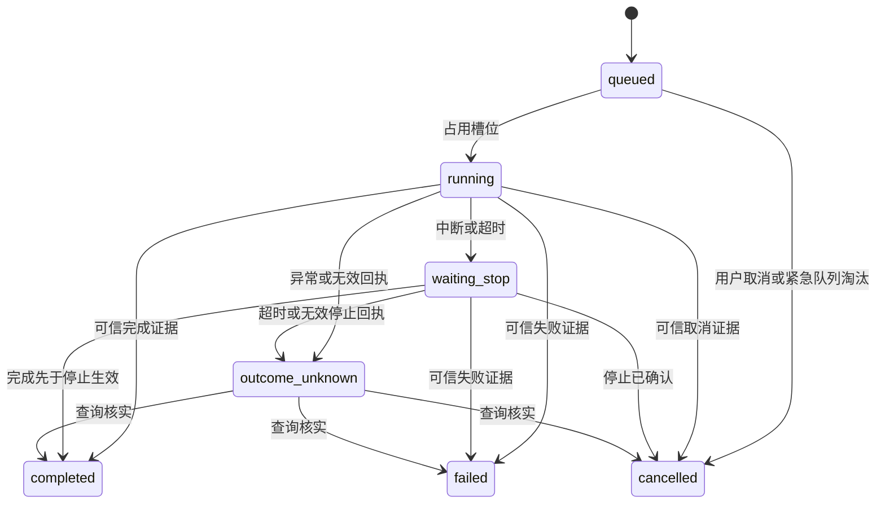

# 内核版本 0.1 接口与不变量

本文件描述实际实现的契约，与 [全量系统设计](system-contracts.md) 区分。当前实现覆盖 M01、M03、M04、M08、M14、M20 的首批内核子产物，不意味着这些模块全范围完成。

## 核心对象

| 对象 | 实现字段 | 校验或所有权 |
| --- | --- | --- |
| Signal | text、event_id、trace_id、source、schema_version | 仅 1.0；文本非空且不超过 16 KiB；source 为 user 或 sensor |
| Decision | priority、salience、capability、arguments、reason | 由 Attention 内部生成，不从外部文本反序列化执行 |
| Action | id、task_id、generation、epoch、capability、arguments、idempotency_key、trace_id | Journal 占用槽位时生成，先 prepared 再 sending |
| Result | action_id、generation、epoch、status、evidence、detail | 必须匹配原动作，status 为 completed、cancelled 或 failed，证据非空 |
| StopReceipt | action_id、generation、epoch、stopped、evidence | 原动作匹配、stopped 为真且有证据；仅收到请求不构成停止 |
| Snapshot | revision、items、byte_count | 不可变；Item 记录来源、类型、正文和 pinned 标记 |

Action 的 generation 与 epoch 标识原动作尝试，不能因为新输入到达就修改原动作身份。当前没有异步模型规划，因此尚无独立的 decision_generation；未来 M13 接入时再增加它，不能混用原动作代次。

## 运行状态

终态不可再变更。prepared 的未发送恢复是 running → cancelled 的特例，证据来自日志中尚未进入 sending。任务变更和相应事件在同一事务提交，revision 支持比较检查。当前没有 paused 状态；技能级检查点未实现前，不把任意动作取消包装成可恢复暂停。

## 外部执行边界

Driver.execute(Action) 返回最终 Result；Driver.stop(Action) 返回 StopReceipt；Driver.query(Action) 返回可信最终结果或 None。None 只代表无法确认，不代表未执行。执行和停止可同时等待同一个动作，后者属于控制协议，不算第二个普通动作。

当前模拟能力为 say 与 alert，参数只有非空字符串 text。模拟器持久化幂等键对应的完整动作内容；同键不同内容拒绝，已有最终回执返回同一结果，未终结旧记录拒绝重发。

运行时对动作结果、停止和查询分别设置超时。超时不通过 cancel 协程假装物理动作停止；调用可能迟到，任务保持未知，之后显式 reconcile。收到第二个中断时，不取消已经进行的停止协议。

## 异常与恢复要求

| 情况 | 实际处理 |
| --- | --- |
| 普通队列满 | BACKPRESSURE；输入不进入 accepted 状态 |
| 紧急输入遇满队列 | 可原子淘汰一个未运行的普通任务；全是紧急任务时也返回背压 |
| 相同输入 ID 内容变化 | DUPLICATE_CONFLICT，不覆盖旧事件 |
| 任务非法状态变更或版本不符 | REVISION_CONFLICT，事务回滚 |
| 约束条数或字节超预算 | CONTEXT_OVERFLOW；原快照保持不变 |
| 数据库被另一运行实例占用 | STORE_BUSY，不启第二个写入者 |
| 执行器通信异常、取消协程或错误回执 | outcome_unknown，冻结后续动作 |
| 执行中发生存储故障 | 尝试有界停止，运行时进入故障状态，不继续派发；重启后核实 |
| 驱动返回可信 failed | 任务失败，可继续独立队列任务 |

SQLite 的事务、消费检查点与 POSIX 锁用于单主机一致性，不提供硬件侧恰好一次保证。若出现未知 schema 版本，启动失败而不自动覆盖版本号。生产级迁移工具、备份命令与多节点所有权仍是后续任务。
