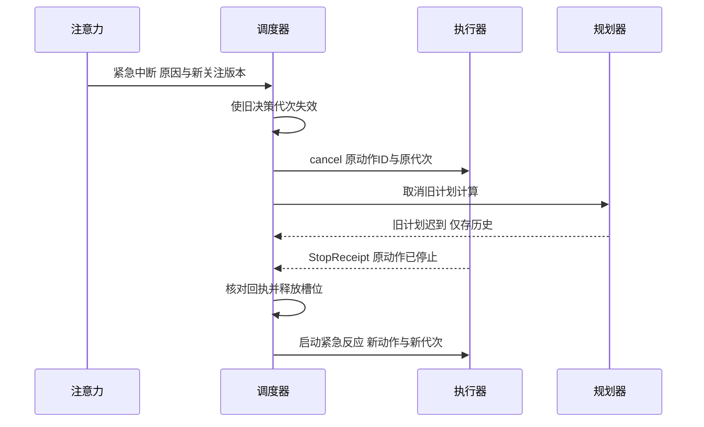

# 跨模块协议与系统验证

本文件约束 20 个模块之间的交互。模块内算法可以替换，但事件来源、状态所有权、动作停止和证据语义必须一致。阈值与样本规模是第一轮开发的验收起点，研究阶段可凭基线证据调整，并记录调整理由及版本。

## 必须保持的不变量

| 编号 | 不变量 | 主要责任 |
| --- | --- | --- |
| INV01 | 每台机器人最多一个有效关注版本 | M03 |
| INV02 | 普通外部动作并发数不超过 1 | M08、M14 |
| INV03 | 旧动作没有结果或停止证据，不释放动作槽位 | M08、M14 |
| INV04 | 过时计划不能启动新动作，但旧动作回执仍必须核对 | M08、M13、M14 |
| INV05 | 每条生效事实有证据、有效时间和版本 | M05、M18 |
| INV06 | 未验证的技能、角色、反射候选不进入生效策略 | M12、M15、M16、M17 |
| INV07 | 假设与事实在存储和默认检索中分离 | M04、M05、M19 |
| INV08 | 已受理事件持久化，重复事件不重复生效 | M01 |
| INV09 | 任务执行完不等于目标达成；完成需要可观察证据 | M07、M14 |
| INV10 | 队列、调用、重试、递归和存储都有预算 | 各模块、M01、M20 |
| INV11 | 情绪、角色和学习不能改变动作硬约束 | M10、M12、M14、M15 |
| INV12 | 回放默认使用模拟适配器，不产生真实外部动作 | M20 |

## 事件交互目录

| 事件 | 生产者 | 消费者 | 核心载荷及失效规则 |
| --- | --- | --- | --- |
| observation.created | M02 | M03、M06、M05 | 原始来源、时间范围、置信度、revision |
| focus.changed | M03 | M04、M08、M13 | focus_version、组成员、切换原因；旧关注的候选待重验 |
| context.ready | M04 | M13 | 不可变快照、证据版本、预算 |
| memory.revised | M05、经 M18 决策 | M04、M06、M13、M15 | 旧新版本、受影响引用；只撤销依赖该事实的候选 |
| scene.changed | M06 | M04、M11、M12 | 关系差异与实体映射版本 |
| goal.eligible | M07 | M11、M13 | 成功条件、依赖已满足、预算 |
| self.changed | M09 | M04、M11、M14 | 字段有效性、采样时间、能力变化 |
| affect.changed | M10 | M11、M12、输出样式 | 数值、标签、刺激来源和有界偏好 |
| motive.selected | M11 | M07 | 来源、目标模板、冷却及失效条件 |
| role.changed | M12 | M04、M11 | 角色版本及生效时间 |
| plan.proposed | M13 | M08 | 校验结果、上下文版本、步骤图与预算 |
| action.requested | M08 | M14 | 动作、能力版本、epoch、generation、幂等键 |
| action.result | M14 | M08、M07、M09、M15 | 结果状态、效果证据、原动作代次 |
| stop.confirmed | M14 | M08 | 原动作 ID、实际停止证据和时刻 |
| candidate.evaluated | M15 | M12、M16、M17 | 类型、版本、数据与评估报告，不等同发布 |
| reflex.activated | M17 | M08 | 生效规则版本、触发证据、候选动作 |
| conflict.opened | M18 | M05、M07、M13 | 冲突集合、待核实条件 |
| hypothesis.proposed | M19 | M04、M07 | 种子证据、验证方法、成本与截止时间 |

事件发布走 M01。M05 是事实写入所有者，M18 通过其修订事务提交；表中列出决策来源不意味着两个模块可直接并发写同一事实。错误事件包含 code、retryable、owner、correlation 和 next_condition，不以异常字符串替代协议。

## 契约示例与版本处理

下面是停止确认的设计样例，ID 为说明用值。机器人已开始新的决策代次时，这份回执仍用原动作的代次 17 匹配正在等待停止的动作。

```json
{
  "schema_version": "1.0",
  "event_id": "evt-stop-002",
  "robot_id": "robot-demo",
  "trace_id": "trace-042",
  "causation_id": "evt-cancel-001",
  "source": "driver.simulated",
  "type": "stop.confirmed",
  "occurred_at": "2026-10-28T01:00:00.120Z",
  "received_at": "2026-10-28T01:00:00.130Z",
  "payload": {
    "action_id": "action-041",
    "generation": 17,
    "epoch": "boot-003",
    "stop_request_id": "stop-001",
    "driver_sequence": 88,
    "stopped": true,
    "evidence_refs": ["telemetry-088"]
  }
}
```

接收者先检查 schema 主版本、robot_id 和 event_id，再检查 action_id、原 generation 与 epoch；匹配后读取证据并推进状态。仅凭 stopped=true 且没有驱动认可的状态证据不释放槽位。设备支持的证据类型在能力描述中声明，模拟器使用模拟遥测，真实设备使用已验证驱动回执或状态查询。

| 错误码 | 可自动重试 | 恢复条件 |
| --- | --- | --- |
| SCHEMA_UNSUPPORTED | 否 | 配置兼容迁移器或升级消费方 |
| BACKPRESSURE | 有界重试 | 队列有余量且请求未过期；沿用 event_id |
| STALE_CONTEXT | 不复用原计划重试 | 重新装配快照或证明变化与步骤无关 |
| MODEL_TIMEOUT | 同一预算内可重试 | 目标仍有效、预算未耗尽 |
| PRECONDITION_FAILED | 否 | 新观察证明条件满足或生成新计划 |
| OUTCOME_UNKNOWN | 禁止重发原动作 | 查询或幂等核对得到可信结果 |
| EVIDENCE_MISSING | 否 | 补充证据或把结论降为未验证 |
| BUDGET_EXHAUSTED | 否 | 目标被显式调整预算或终止 |

接口契约先通过内存调用与事件订阅实现；若未来跨进程，传输层可以变化，错误和幂等语义保持一致。状态变更请求携带 expected_revision，版本冲突返回当前版本而非覆盖。生产启动禁止自动降级读取未知 schema；只读回放可以使用显式迁移器并记录迁移版本。

## 关键时序



如果停止超时，流程终止于等待核实，不能继续最后一步。独立硬件急停可以在等待期间发出，它是停止控制消息，不是并发普通动作。真实设备控制器负责低层实时安全，Python 认知循环不承担硬实时电机控制。

## 动作和证据事务边界

系统不得宣称“记录一次就只执行一次”。持久化动作意图与设备效果跨越两个系统。将故障窗口分为：意图写入前、意图写入后发送前、发送后回执前、回执后终态前。前三者分别通过未受理、可确认未发送、查询或幂等核对处理；无法区分是否已发送时必须进入未知状态。最后一类从回执重建终态。

记忆修订事务同时写新版本、冲突决策和待通知项；索引和摘要作为派生数据异步更新，带 revision。规划执行前读取权威版本，不能因索引尚未重建继续使用已撤回事实。对不影响动作前置条件的背景修订，允许计划继续，避免全局重规划风暴。

## 全链路场景集

| 场景 | 触发与故障 | 预期及不变量 | 主要模块 |
| --- | --- | --- | --- |
| C01 | 问候与点名交错 | 选组稳定，输出不作为新请求循环 | M02、M03、M04、M14 |
| C02 | 普通动作中收到火警 | 等停止证据再执行新动作，INV02–04 | M03、M08、M14 |
| C03 | 重投消息并填满普通队列 | 幂等、有背压、紧急入口可用，INV08、10 | M01、M03、M08 |
| C04 | 可确定失败后仍有独立任务 | 故障隔离，前置条件满足才继续 | M08、M14 |
| C05 | 停止回执丢失或无限延迟 | 未知状态冻结，不虚报已停，INV03 | M08、M14 |
| C06 | 电量阈值抖动及遥测过期 | 动机去重、有迟滞，过期能力不使用 | M09、M11 |
| C07 | 模型坏格式、假能力和超时 | 拒绝或降级，无非法动作 | M13、M14 |
| C08 | 同实体矛盾与跨时间变化 | 冲突与变化分开，保留版本，INV05 | M05、M06、M18 |
| C09 | 长期无用户输入 | 定时目标推进、空闲有界、可抢占 | M07、M11、M19 |
| C10 | 图片模糊、语音噪声及断流 | 不确定观察有来源，不捏造实体 | M02、M06 |
| C11 | 技能跨环境成功与失败 | 候选限制适用范围，未验证禁用 | M15、M16 |
| C12 | 联想内容与事实相似 | 假设隔离，不自动转事实，INV07 | M04、M05、M19 |
| C13 | 发送动作后崩溃 | 核实效果，不盲目重发 | M01、M08、M14 |
| C14 | 多次中断和旧计划迟到 | 停止协议不被取消，旧结果不驱动新动作 | M08、M13、M14 |
| C15 | 真实驱动断连恢复 | 先核实状态，再恢复任务 | M09、M14、硬件阶段 |
| C16 | 超长会话挤压上下文 | 硬约束不截断，证据可追溯 | M04、M13 |
| C17 | 遮挡、同名和实体错误合并 | 可保留多候选、拆回映射及历史关系 | M06、M18 |
| C18 | 定时器错过周期、跨时区与重启 | 按策略补跑，同一期只生成一次 | M01、M07 |
| C19 | 情绪持续受刺激及刺激解除 | 数值有界、能恢复、不改硬约束 | M10、M11 |
| C20 | 临时角色扮演与多人偏好冲突 | 不错误固化角色、不添加执行能力 | M12、M15 |
| C21 | 证据撤回及索引落后 | 派生事实失效，旧检索不能绕过权威版本 | M04、M05、M18 |
| C22 | 多反射互斥及重复刺激 | 明确仲裁、有限触发、仍经调度 | M03、M17、M08 |
| C23 | 技能升级时已有实例暂停 | 版本固定，恢复不重复已完成效果 | M08、M16 |
| C24 | 学习数据重复与验证集泄漏 | 分组隔离，拒绝不独立的成功证据 | M15、M20 |
| C25 | 长期运行、备份恢复及回放 | 预算稳定、可恢复、回放无真实动作 | M01、M05、M20 |

## 数据集与量化门槛

所有数据划分按场景、设备或采集会话隔离。开发集用于调参，冻结验收集只用于准入与回归；修改验收集需记录原因，不能删除难例以提高指标。基础阶段先建设 200 条标注文本事件与 50 条任务轨迹；认知阶段扩至至少 300 条带证据检索查询和 100 个可判定规划任务；多模态阶段每种已接入模态至少 100 个分层样本。样本量是起步规模，不足以证明开放环境泛化。

| 项目 | 初始验收门槛 | 方法及限制 |
| --- | --- | --- |
| 状态与串行不变量 | 固定 1000 条轨迹和生成的 10000 条事件序列中零违规 | 每次运行保留种子；零违规不代表形式证明 |
| 规则紧急通道 | 输入受理到发出停止请求 p95 ≤100ms | 固定测试机、20 条文本事件/秒，报告 p99 与最大值；不含硬件停止 |
| 紧急规则召回 | 枚举的必须触发样例全部触发 | 开放语音视觉报告独立漏报率，不外推为全覆盖 |
| 检索 | 冻结查询集 Recall@10 ≥0.85，证据引用可追溯率 100% | 对时间、实体冲突单列分层结果；小样本附区间 |
| 规划 | schema 与语义检查后的非法计划下发数为 0；仿真任务成功率 ≥0.80 | 有效计划比例与拒绝率也须报告，防止靠全部拒绝达标 |
| 学习候选 | 必须有独立验证、反例及基线比较，禁止生效泄漏 | 成功率阈值按技能代价分档，未定阈值则不发布 |
| 存储与恢复 | 已确认事件在故障矩阵中不丢失；未知动作无重复发送 | 注入事务与发送窗口故障，保留核对结果 |
| 长跑 | 72 小时仿真运行无无界队列和未解释任务 | 检查容量上限、稳定输入下内存增长及日志轮转 |

模型、设备、测试机与配置冻结后再接受具体性能承诺。达不到算法门槛时，优先限制支持领域、保留规则或请求澄清；不能通过降低硬不变量标准交付。

## 待验证研究问题及退出路径

| 研究问题 | 实验入口 | 无法达标的交付路径 |
| --- | --- | --- |
| 模态置信度与融合是否可靠 | M02 噪声及对齐集 | 保留独立观察，降低自动融合范围 |
| 关注切换能否兼顾召回与稳定 | M03 混合事件轨迹 | 规则类别和人工可解释权重 |
| 摘要是否保留关键约束 | M04 长上下文集 | 提取式摘要、缩小任务上下文 |
| 语义检索是否优于全文基线 | M05 查询基准 | 结构过滤加全文检索 |
| 实体关联是否会错误合并 | M06 场景轨迹 | 多候选保留，显式 ID 关联 |
| 情绪与动机参数是否稳定 | M10、M11 长跑 | 固定参数与简化需求策略 |
| 角色学习是否错误固化偏好 | M12 临时指令集 | 仅显式配置角色，学习候选只建议 |
| 复杂规划是否真正改善成功率 | M13 仿真任务集 | 模板技能加短计划，增加澄清 |
| 学习能否跨环境泛化 | M15、M16 扰动实验 | 环境受限技能，禁止自动发布 |
| 学习反射是否降低总错误代价 | M17 反例和对照组 | 只启用预置规则 |
| 开放文本冲突是否可可靠裁决 | M18 语义反例 | 结构化冲突裁决，开放文本仅提示 |
| 联想是否有可量化收益 | M19 消融与成本实验 | 手动触发或关闭空闲联想 |

研究没有正结果也必须交付基线、失败样例和范围决定；报告“模块完成”必须同时声明支持的领域和保留的限制。
